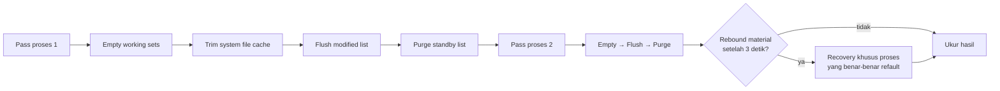

<div align="center">

# 🧠 Reduce Memory

**Bikin RAM lega lagi di Windows dan Linux, tanpa menutup satu aplikasi pun.**

[](https://github.com/fel-gg/memory-reduce/actions/workflows/verify.yml)
[](https://github.com/fel-gg/memory-reduce/releases/latest)

[](LICENSE)

</div>

Reduce Memory meminta sistem operasi melepas memori yang sedang tidak dipakai
aplikasi di background, lalu **mengukur hasilnya dengan jujur**. Tidak ada proses
yang dimatikan. Aplikasi tetap berjalan dan memuat ulang datanya sendiri saat
dibutuhkan.

> Bukan antivirus, bukan registry cleaner, dan bukan "RAM booster" yang
> menjanjikan angka ajaib. Yang ditampilkan hanya angka sebelum/sesudah yang
> benar-benar terukur.

---

## ✨ Kenapa Reduce Memory

- **Aman untuk aplikasi yang sedang dipakai.** Jendela aktif, aplikasi yang baru
  dipakai, proses yang sedang sibuk CPU, dan proses inti Windows/Linux dilewati.
- **Belajar dari hasil.** Aplikasi yang langsung "makan RAM lagi" setelah dipangkas
  otomatis diberi jeda 30 menit, jadi tidak ada siklus trim → lag → trim.
- **Hasil yang bisa dipercaya.** Perubahan working set per proses dan Available RAM
  sistem dihitung terpisah. Kalau sesudah trim tidak bisa diukur, hasilnya ditulis
  `unknown`, bukan dianggap berhasil.
- **Dua engine asli.** Windows memakai working-set trim + memory list; Linux memakai
  `process_madvise(MADV_PAGEOUT)` dan cgroup v2. Bukan port setengah jadi.
- **Aplikasi baru otomatis ikut.** Kandidat dipilih dari perilaku proses, bukan dari
  daftar nama aplikasi.

## 🚀 Mulai cepat

### Windows

1. Download ZIP Windows dari [Releases](https://github.com/fel-gg/memory-reduce/releases/latest),
   atau ambil folder [`windows/`](windows/) dari repo ini (build terbaru `main`).
2. Simpan semua file di folder `windows/` bersama-sama.
3. Jalankan `ReduceMemory_x64.exe` (64-bit) atau `ReduceMemory.exe` (32-bit).
4. Pilih mode, klik **Optimize**.

Izin Administrator hanya diminta saat mode yang dipilih memang membutuhkannya.

### Linux desktop

```bash
cd linux
chmod +x ReduceMemory_Linux.sh desktop/Install_Desktop.sh
./desktop/Install_Desktop.sh
```

Setelah itu buka **Reduce Memory** dari menu aplikasi.

### Linux server / VPS

```bash
cd linux
chmod +x ReduceMemory_Linux.sh server/Install_Server.sh
sudo ./server/Install_Server.sh
sudo reduce-memory-server smooth
```

Mode server bekerja lewat SSH/terminal, tanpa service, daemon, atau cron.

## 🎛️ Pilih mode

| Mode | Cocok untuk | Admin | Kekuatan |
| --- | --- | :---: | --- |
| **Normal Optimize** | Pemakaian harian | – | Aplikasi background besar (≥ 96 MB) yang idle |
| **AI Shield** | Saat menjalankan AI/LLM lokal | – | Seperti Normal, tapi proses AI/GPU beserta child-nya dilindungi |
| **Aggressive Smooth** | Rutin, tanpa bikin lag | ✅ | Trim elevated + lepas standby prioritas rendah |
| **Aggressive Release** | RAM sudah sesak | ✅ | Dua pass + pelepasan memory list penuh + recovery rebound |
| **Aggressive + Delete Temp** | Bersih-bersih sekaligus | ✅ | Aggressive, lalu menawarkan hapus `%TEMP%` dan `C:\Windows\Temp` |
| **Emergency Release** | Darurat, sistem hampir macet | ✅ | Paling kuat, jendela aktif juga ikut dipangkas (ada konfirmasi) |

Di Linux tersedia `normal`, `smooth`, `ai-shield`, `aggressive`, dan `status`/`check`
(hanya membaca, tidak mengubah apa pun).

## ⚙️ Cara kerja Aggressive (Windows)



- Halaman "dirty" di-flush dulu sebelum purge, supaya ikut menjadi RAM kosong.
- Recovery hanya menyentuh proses yang terbukti mengambil kembali ≥ 16 MB dengan
  page fault nyata, bukan menyapu ulang semua aplikasi.
- 15 detik kemudian hasil **stabil** dihitung ulang. Kalau RAM langsung terpakai
  lagi, operasi berat ditahan 60 detik (rebound protection).

Proses dipangkas oleh worker C native (x86/x64). Kalau worker hilang atau hasilnya
tidak valid, aplikasi kembali ke engine AutoIt yang sudah tervalidasi.

## 🛡️ Keamanan & privasi

- **Tidak ada proses yang dimatikan.** Selain mode Emergency, jendela aktif selalu
  dilindungi.
- **Delete Temp bersifat permanen.** Aplikasi selalu minta konfirmasi, file yang
  sedang dipakai dilewati, dan symlink/junction tidak pernah diikuti.
- **Startup opsional.** Kalau diaktifkan, program menjalankan satu Normal pass
  10 detik setelah login, lalu hanya berjalan lagi saat RAM ≥ 95% dua kali
  berturut-turut (cooldown 5 menit, aktif lagi setelah turun ke 90%). Tidak ada
  UAC dan tidak ada Aggressive/Emergency saat login.
- **Data yang disimpan** hanya riwayat efektivitas kecil di
  `%LOCALAPPDATA%\ReduceMemory\effectiveness.ini` (maksimal 128 entri, tanpa PID)
  dan log ringkas `windows/ReduceMemory.log` yang dirotasi ke `.log.1` di 128 KB.

## 🐧 Linux: kebutuhan

- Kernel 5.10+, Python 3, Bash, `awk`, dan `sync`.
- Page-out native membutuhkan `sudo` (izin ptrace dan `CAP_SYS_NICE`).
- Swap aktif membantu kernel memindahkan memori anonymous yang dingin.
- Proses root/system, kernel thread, locked memory, dan mapping khusus kernel
  selalu dilewati.

Detail lengkap ada di [`linux/README.md`](linux/README.md).

## 📁 Isi repo

```
windows/   Aplikasi Windows (x86/x64), worker native, INI, script build
  native/  Source worker C
src/       Source utama AutoIt (UI + engine Windows)
linux/     Launcher Bash, helper native Python, installer desktop & server
tests/     Tes Windows, Linux, kontrak, benchmark, dan release
docs/      Riwayat versi, support matrix, protokol worker, catatan progres
```

## 🔧 Build & tes dari source

Siapkan **AutoIt 3.3.18.0** portable dan **Zig 0.16.0**, lalu:

```powershell
.\windows\build.ps1 `
  -AutoItRoot C:\toolchains\AutoIt3 `
  -ZigPath C:\toolchains\zig\zig.exe `
  -OutputDirectory C:\temp\ReduceMemory-build
```

Hasilnya frontend + worker x86/x64 dan `BUILD-MANIFEST.json`. Self-test aman
(tidak memangkas RAM):

```powershell
.\windows\ReduceMemory_x64.exe /RMSELFTEST
.\windows\ReduceMemory_x64.exe /RMMEASUREMENTSELFTEST
```

Tes Python:

```bash
python -m unittest discover -s tests/contracts -p "test_*.py"
python -m unittest discover -s tests/benchmark -p "test_*.py"
python tests/linux/test_native_unit.py
```

Setiap push ke `main` diverifikasi CI di Windows serta Ubuntu 22.04/24.04:
build dari source, trim nyata ke proses uji, refault recovery, engine
Aggressive penuh, page-out Linux, dan installer.

## 📚 Dokumen

- [Riwayat versi](docs/VERSION_HISTORY.md)
- [Platform yang sudah diuji](docs/SUPPORT-MATRIX.md)
- [Protokol worker native](docs/WORKER-PROTOCOL.md)
- [Catatan progres](docs/PROGRESS.md)

## 🙏 Kredit & lisensi

Terinspirasi dari **Reduce Memory v1.7** buatan Sordum Team (BlueLife). Proyek ini
**bukan** binary resmi Sordum. Source AutoIt dan engine native di sini adalah
pengembangan terpisah yang mempertahankan ide dasar working-set trimming. Periksa
provenance dan lisensi upstream sebelum redistribusi.

Kode di repo ini dirilis dengan [MIT License](LICENSE).
